## Sobre

Software Engineer na **Tiix**, com foco em **front-end** e atuação full-stack. Construo interfaces com React, TypeScript e Next.js e trabalho no backend com PHP e Python, usando MySQL e PostgreSQL. Estudo **Análise e Desenvolvimento de Sistemas** na UERJ-ZO.

## Experiência

**Tiix** · Software Engineer · 2026 – atual  
Desenvolvimento front-end da plataforma da Tiix, criando e mantendo telas com PHP, JavaScript, HTML e CSS.

## Projetos

Os repositórios são privados; os links levam aos sites no ar.

| Projeto | O que é | Stack |
| :--- | :--- | :--- |
| **[NaFavela](https://nafavela.com)** | Marketplace de imóveis e comércio local nas comunidades do Rio, com 275 comunidades cadastradas e app Android. | Django · Python · PostgreSQL |
| **[Santana Trufas](https://santana-trufas.vercel.app)** | Site de link na bio de uma loja de trufas: cardápio, encomendas enviadas pelo WhatsApp e painel do dono com vendas, pedidos e relatórios. | Next.js · TypeScript · Tailwind · SQLite |
| **[Hidrabella](https://hidrabella.vercel.app)** | Protótipo de redesign de um e-commerce de cosméticos: catálogo com filtros, quiz de rotina, monte seu kit, checkout em etapas e painel admin. | Next.js · TypeScript · Tailwind · PostgreSQL |
| **CellTop Exclusivo** | PDV que roda no computador da loja: o celular vira leitor de código de barras pela câmera, com recibo em PDF, controle de estoque e fechamento de caixa. | Python · FastAPI |

## Formação

**UERJ-ZO** · Análise e Desenvolvimento de Sistemas · em andamento  
Projeto de Construção de Algoritmos: [Tabuleiro Minhoca](https://github.com/DanyltonLima/Tabuleiro-minhoca---trabalho-faculdade), simulação em C de uma minhoca num tabuleiro 10×10 com obstáculos.

## Stack

| Área | Tecnologias |
| :--- | :--- |
| **Front-end** |        |
| **Back-end** |     |
| **Banco de dados** |   |
| **Ferramentas** |    |
